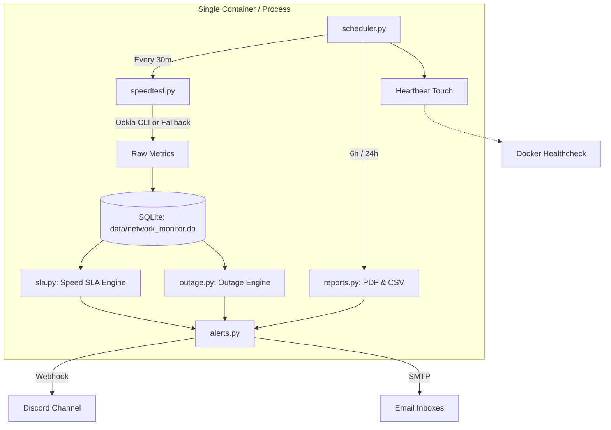

# ISP Speed Monitor (v1.1)

A robust, self-contained network performance monitor with ISP SLA breach detection, outage tracking, and embedded SQLite storage.

Runs automated speed tests, records latency/jitter/packet loss, evaluates contractual SLA compliance against your ISP plan, and delivers real-time Discord notifications and email reports with CSV/PDF evidence.

---

## What's New in v1.1

- **SQLite Embedded Storage:** Replaced PostgreSQL with SQLite (`PRAGMA journal_mode=WAL;`). No database container, no passwords, zero connection race conditions, and portable single-file backups.
- **Dedicated Outage Tracking (D1):** Connectivity drops and test failures are tracked in an `outage_episodes` state machine and no longer skew speed breach calculations.
- **Official Ookla CLI Support (D2):** Automatically detects and executes the official Ookla CLI (`speedtest --format=json`) for Gigabit-accurate measurements, jitter, packet loss, and official **speedtest.net verification URLs**. Gracefully falls back to `speedtest-cli` if not installed.
- **Single Container Deployment:** Simplified `docker-compose.yml` to a single container mounting `./data` and `./logs`.
- **Fast Offline Tests:** 100% test coverage running against in-memory SQLite in under 2 seconds.

---

## Features

- **Scheduled Speed Tests:** Runs every 30 minutes (configurable) capturing download, upload, latency, jitter, and packet loss.
- **ISP SLA Breach Detection:** Declares a breach when speed drops below contractual minimum (>20% of valid checks in a 24-hour rolling window).
- **Outage Monitoring:** Detects total connection drops, records downtime duration, and sends "Restored" notifications.
- **Multi-Channel Alerts:**
  - **Discord:** Compact, glanceable webhook cards for SLA Breaches, Resolution notices, and Outage alerts.
  - **Email:** HTML summary table with in-memory CSV evidence attachments for filing ISP dispute tickets.
- **Periodic Summaries:** 6-hour summary emails and daily PDF/CSV reports.
- **Container Health Checks:** Built-in `.heartbeat` verification for Docker `HEALTHCHECK`.

---

## Architecture



---

## Quickstart

### 1. Docker (Recommended)

```bash
# 1. Copy example configuration
cp .env.example .env

# 2. Edit .env with your ISP plan details and webhook/SMTP settings
nano .env

# 3. Start monitor
docker compose up -d
```

Check logs:
```bash
docker compose logs -f
```

### 2. Local Setup (with `uv`)

Requires Python ≥ 3.10 and [`uv`](https://docs.astral.sh/uv/).

```bash
# 1. Install dependencies
uv sync

# 2. Configure environment
cp .env.example .env

# 3. Run monitor
uv run python main.py
```

---

## Configuration (`.env`)

```ini
# ISP Plan Configuration (Contractual SLA)
ISP_PLAN_NAME="GFiber Plan 1999"
ISP_PLAN_SPEED=500        # Advertised download Mbps
ISP_PLAN_UPLOAD_SPEED=500 # Advertised upload Mbps
ISP_PLAN_THRESHOLD=150    # Minimum contractual download Mbps (e.g. 30% of advertised)
ISP_PLAN_UPLOAD_THRESHOLD=150

# SLA Breach Rule Configuration
SLA_WINDOW_HOURS=24       # Rolling assessment window (hours)
SLA_VIOLATION_PCT=20.0    # Breach declared if > 20% of checks in window are below threshold
SLA_MIN_COVERAGE=0.75     # Minimum ratio of expected checks required to evaluate SLA (75%)

# Speed Alert Thresholds (for periodic report "slow incident" counts)
SPEED_ALERT_DOWNLOAD=500
SPEED_ALERT_UPLOAD=300

# SQLite Database Storage
DB_PATH=data/network_monitor.db

# Discord Alerts (leave empty to disable)
DISCORD_WEBHOOK_URL=https://discord.com/api/webhooks/...

# Email Configuration (optional, leave empty to disable)
SMTP_SERVER=smtp.gmail.com
SMTP_PORT=587
SMTP_USER=your_email@gmail.com
SMTP_PASSWORD=your_app_password
EMAIL_RECIPIENT=recipient@example.com

# Schedule
CHECK_INTERVAL_MINUTES=30
SUMMARY_INTERVAL_HOURS=6
DAILY_REPORT_TIME=23:59
```

---

## How SLA Evaluation Works

1. **Measurement:** Every 30 minutes, a speed test is executed.
2. **Outage Check:** If the test fails (e.g., DNS error, no WAN connection), it is recorded as `status='failed'`. The outage state machine starts an `outage_episodes` record and alerts Discord.
3. **Speed SLA Window:** The speed engine queries valid checks (`status='ok'`) within the 24-hour window.
4. **Coverage Guard:** SLA is only evaluated once at least 75% of expected checks exist in the rolling window.
5. **Breach Determination:** If $>20\%$ of valid checks fall below `ISP_PLAN_THRESHOLD`, an SLA breach episode opens, sending Discord and email evidence. Alerts are silenced while the episode is ongoing.
6. **Recovery:** Once violation rates drop back within standard, the episode closes and a recovery notice is issued.

---

## Testing

Run the offline pytest suite:

```bash
uv run --group dev pytest -v
```

All 28 tests execute in ~1 second using in-memory SQLite and mocks.

---

## Grafana Integration

You can visualize the SQLite database directly in Grafana using the official [frser-sqlite-datasource](https://grafana.com/grafana/plugins/frser-sqlite-datasource/) plugin:

```sql
-- Speed over time
SELECT timestamp, download_speed, upload_speed 
FROM network_checks 
WHERE status = 'ok'
ORDER BY timestamp ASC;

-- Outage episodes
SELECT started_at, ended_at, duration_seconds, reason 
FROM outage_episodes 
ORDER BY started_at DESC;

-- SLA breach episodes
SELECT started_at, ended_at, worst_download_speed, violation_pct 
FROM sla_breach_episodes 
ORDER BY started_at DESC;
```
