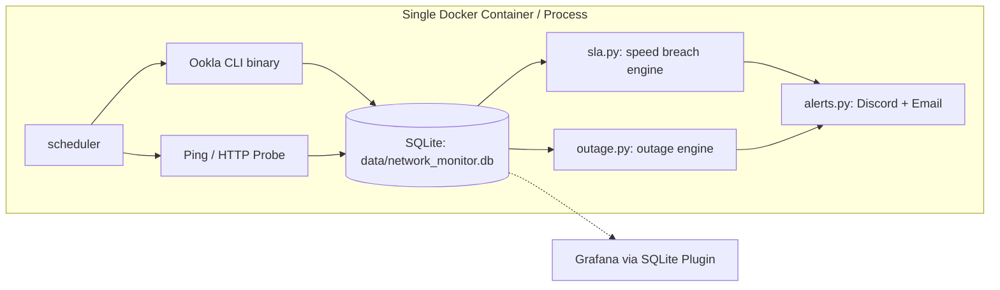

# codex-network-py — Improvement Scope

> Status: **Updated with user decisions (D1: Outages, D2: Ookla CLI, Storage: SQLite)** · Date: 2026-10-10 · Base commit: `8e852d9`

## 1. Summary

The monitor runs speed tests, stores results in a database, and alerts on ISP SLA breaches. The modular structure from the recent refactor is clean. 

Per your decisions, this revision makes three fundamental changes:
1. **Switch storage to SQLite:** replace PostgreSQL with embedded SQLite (`sqlite3`). A monitor that writes one row every 30 minutes (~17,500 rows/year) does not need an external PostgreSQL server. This eliminates the database container, network errors, credentials, and psycopg2 binary dependencies.
2. **Track failures as outages (D1):** exclude failed tests from the speed violation ratio. Record failures as connectivity incidents and track them in an outage state machine.
3. **Use the official Ookla CLI (D2):** replace `speedtest-cli` with the official Ookla binary for accurate 500 Mbps measurements, packet loss, jitter, and verified result URLs.

This scope has four phases. Each phase ships independently.

| Phase | Goal | Size |
|---|---|---|
| **1. Fix, SQLite & harden** | Migrate to SQLite. Fix SLA math. In-memory test suite. Single-service Docker. | M (1–2 days) |
| **2. Ookla & outage tracking** | Official Ookla CLI, ping probe, outage episodes, evidence URLs. | M (2 days) |
| **3. Observability** | Self-contained Grafana profile or light metrics. Container health checks. | S–M (1 day) |
| **4. Optional extras** | Monthly ISP dispute PDF, resolve alerts, multi-channel notifications. | S each |

---

## 2. Architecture comparison

### Before (PostgreSQL)
```mermaid
flowchart LR
    subgraph compose[Docker Compose]
        APP[app container: python 3.11 + psycopg2]
        PG[(db container: postgres 15)]
    end
    APP -->|TCP 5432 + auth| PG
    APP -->|every 30 min| PYST[speedtest-cli (Python)]
    APP -->|webhook| D[Discord]
    APP -->|SMTP| E[Email]
```

### Proposed (SQLite + Ookla CLI)


---

## 3. Why SQLite is the right choice

| Dimension | PostgreSQL (Current) | SQLite (Proposed) |
|---|---|---|
| **Infrastructure** | Requires separate container, volume, port mapping, and network bridge. | Zero external services. Single file on mounted volume (`./data:/app/data`). |
| **Dependencies** | Requires `psycopg2-binary`, C libraries, and build tools in Docker. | Built into Python standard library (`sqlite3`). No external driver needed. |
| **Configuration** | Needs `DB_HOST`, `DB_NAME`, `DB_USER`, `DB_PASSWORD`. | Needs only `DB_PATH=data/network_monitor.db`. Zero credentials. |
| **Cold start** | Race condition: app crashes if Postgres is not ready yet. | Instant start. Zero connection delay. |
| **Interval syntax** | PostgreSQL interval formatting caused query syntax errors. | Standard SQLite date functions: `datetime('now', '-' \|\| ? \|\| ' hours')`. |
| **Testing** | Tests failed with `Connection refused` unless Postgres was active. | Tests run anywhere in milliseconds using `:memory:`. Zero mocks needed. |
| **Resource cost** | ~100–150 MB RAM idle for PostgreSQL daemon. | 0 MB overhead outside the Python process. |
| **Write volume** | 48 checks/day = ~1,440 rows/month (~17,500/year). | Far below SQLite limits (capable of tens of thousands of writes/second). |

---

## 4. Findings & Resolution Plan

### 4.1 Critical Bugs

| # | Issue | Impact | Resolution in SQLite Architecture |
|---|---|---|---|
| **C1** | Broken interval SQL in PostgreSQL queries. | Breach evaluation failed on every check. Returned empty list. | **Eliminated.** Replaced with clean SQLite query: `SELECT * FROM network_checks WHERE timestamp >= datetime('now', '-' \|\| ? \|\| ' hours')`. |
| **C2** | Dropped measurements on failure. | Scheduler skipped saving when any metric was `None`. Outages went unrecorded. | **Resolved (D1).** Save all attempts. Record status (`ok`, `speedtest_failed`, `timeout`) and error detail. |
| **C3** | Static check count check (`len < 48`). | Missing or failed checks caused permanent evaluation deferral. | **Resolved.** Calculate expected check count dynamically from interval config. Require minimum window coverage ratio (e.g. 90%). |
| **C4** | Dockerfile copied `.env`. | Database passwords and email secrets baked into image layers. | **Resolved.** Remove `COPY .env`. Add `.dockerignore`. Database credentials eliminated entirely. |

### 4.2 Measurement & Evidence

| # | Issue | Impact | Resolution |
|---|---|---|---|
| **M1** | Python `speedtest-cli` under-reports speeds at 500 Mbps+. | False breach alerts; inaccurate ISP dispute data. | **Resolved (D2).** Switch to official Ookla binary (`speedtest --format=json`). |
| **M2** | No verification link for ISP disputes. | ISP support can dispute local script numbers. | Ookla CLI outputs official `result.url` hosted on speedtest.net. |
| **M3** | Outages conflated with slow speeds. | Zero-speed test counted as speed breach rather than connection loss. | **Resolved (D1).** Split into two engines: `sla.py` (contractual speed) and `outage.py` (complete loss of connection). |

### 4.3 Operations & Code Quality

| # | Issue | Resolution |
|---|---|---|
| **O1** | Log path mismatch (`network_monitor.log` in working dir vs `/app/logs`). | Stream logs to stdout/stderr. Optional rotating file handler if `LOG_DIR` is set. |
| **O2** | Docker compose multi-container complexity. | Remove `db` service. Use simple single-container definition with `./data:/app/data`. |
| **O3** | Hardcoded thresholds in email bodies. | Populate values dynamically from active config. |
| **O4** | Tests require live external database. | Point tests to `:memory:` SQLite. 100% test pass rate with no external infrastructure. |
| **O5** | CI workflow has commented-out test steps. | Enable automated lint (`ruff`) and test (`pytest`) on every push and PR. |

---

## 5. Detailed Phase Breakdown

### Phase 1 — SQLite Migration & Core Fixes

**Goal:** Clean, reliable baseline with zero external database dependencies.

1. **SQLite Database Layer (`monitor/db.py`):**
   - Use standard library `sqlite3`.
   - Enable WAL mode (`PRAGMA journal_mode = WAL;`) for robust concurrent reads and writes.
   - Schema creation:
     ```sql
     CREATE TABLE IF NOT EXISTS network_checks (
         id INTEGER PRIMARY KEY AUTOINCREMENT,
         timestamp TEXT NOT NULL,
         download_speed REAL,
         upload_speed REAL,
         latency REAL,
         ip_address TEXT,
         below_threshold INTEGER DEFAULT 0,
         status TEXT NOT NULL DEFAULT 'ok',
         error TEXT
     );

     CREATE TABLE IF NOT EXISTS sla_breach_episodes (
         id INTEGER PRIMARY KEY AUTOINCREMENT,
         started_at TEXT NOT NULL,
         ended_at TEXT,
         worst_download_speed REAL,
         worst_upload_speed REAL,
         violating_check_count INTEGER NOT NULL,
         total_check_count INTEGER NOT NULL,
         violation_pct REAL NOT NULL
     );
     ```
   - Provide helper `get_connection(db_path=None)` supporting `:memory:` for testing.
2. **SLA Math & Outage Policy (D1):**
   - Speed evaluation runs only on checks where `status == 'ok'`.
   - Dynamic window calculation:
     $$\text{expected\_checks} = \frac{\text{SLA\_WINDOW\_HOURS} \times 60}{\text{CHECK\_INTERVAL\_MINUTES}}$$
   - Evaluate breach if:
     $$\text{valid\_checks} \ge \text{expected\_checks} \times 0.90$$
     $$\frac{\text{violating\_checks}}{\text{valid\_checks}} \times 100 > \text{SLA\_VIOLATION\_PCT}$$
3. **Environment & Config:**
   - Remove `DB_HOST`, `DB_NAME`, `DB_USER`, `DB_PASSWORD`.
   - Add `DB_PATH=data/network_monitor.db`.
   - Remove `psycopg2-binary` from `pyproject.toml`.
4. **Docker & Compose:**
   - Remove `db` service from `docker-compose.yml`.
   - Add volume mapping `./data:/app/data`.
   - Remove `gcc` and `libpq-dev` from `Dockerfile`.
   - Remove `COPY .env .`.
5. **Test Suite:**
   - Update `tests/conftest.py` to supply an in-memory SQLite fixture.
   - All tests run offline in < 2 seconds without external services.
   - Restore pytest in `.github/workflows/dev.yml`.

---

### Phase 2 — Ookla CLI & Outage Tracking

**Goal:** Accurate Gigabit speed testing, dispute-ready links, and distinct outage monitoring.

1. **Ookla CLI Integration (`monitor/speedtest.py`):**
   - Download official Ookla binary in Dockerfile / host setup.
   - Run `speedtest --format=json --accept-license --accept-gdpr`.
   - Extract:
     - `download.bandwidth` (converted to Mbps: $\text{bytes/s} \times 8 / 10^6$)
     - `upload.bandwidth`
     - `ping.latency`, `ping.jitter`
     - `packetLoss`
     - `server.id`, `server.name`, `server.location`
     - `result.url` (official speedtest.net link)
   - Fallback to Python `speedtest-cli` if Ookla binary is absent.
2. **Connectivity & Outage Probe (`monitor/probe.py`):**
   - Fast ping or HTTP probe every 60 seconds (against gateway and public DNS `1.1.1.1`).
   - Log outage episodes in new table `outage_episodes`:
     ```sql
     CREATE TABLE IF NOT EXISTS outage_episodes (
         id INTEGER PRIMARY KEY AUTOINCREMENT,
         started_at TEXT NOT NULL,
         ended_at TEXT,
         duration_seconds INTEGER,
         reason TEXT
     );
     ```
   - Alert via Discord on outage start and restoration.
3. **Evidence Packet Enhancement:**
   - Include direct Ookla `result.url` links in Discord cards and CSV attachments.
   - ISPs accept official speedtest.net URLs directly.

---

### Phase 3 — Observability & Operations

**Goal:** Easy visualization and self-healing deployment.

1. **Grafana Integration with SQLite:**
   - Optional `docker-compose.override.yml` or profile for Grafana.
   - Uses the official Grafana SQLite datasource plugin (`frser-sqlite-datasource`).
   - Provisioned dashboard JSON mounted automatically:
     - Speed trends with contractual minimum guideline.
     - Outage duration timeline.
     - Jitter and latency distribution.
     - Public IP change annotations.
2. **Health Monitoring:**
   - App updates a local heartbeat file (`/app/data/.heartbeat`) after each run.
   - Docker `HEALTHCHECK` tests heartbeat freshness.

---

### Phase 4 — Optional Extras

| Feature | Description |
|---|---|
| **Monthly SLA Report** | Automated PDF generated on the 1st of each month with uptime %, total breach hours, and worst incidents for billing dispute. |
| **Resolution Alerts** | Send green notification when an SLA breach clears, detailing total downtime/breach duration. |
| **Optional Email** | Allow running purely with Discord webhook, making SMTP configuration completely optional. |
| **Data Retention Pruning** | Automatic vacuum or retention job keeping detailed checks for 12 months. |

---

## 6. Implementation Decisions Summary

| # | Item | Selected Decision | Rationale |
|---|---|---|---|
| **D1** | Failed checks policy | **Track as outages** | Failed tests represent connection drops, not speed tier violations. Tracked in distinct `outage_episodes`. |
| **D2** | Speed test engine | **Official Ookla CLI** | Handles 500+ Mbps accurately, provides jitter, packet loss, and official `result.url`. |
| **D3** | Storage engine | **SQLite** | Simplifies project from multi-container to single file. Zero credentials, zero networking bugs, instant in-memory tests. |
| **D4** | Email requirement | **Make optional** | Discord webhook is often sufficient; avoid forcing SMTP setup. |
| **D5** | Database migration method | **Lightweight version check** | SQLite `user_version` PRAGMA or simple `schema_version` table. |

---

## 7. Verification Steps

1. **Unit & Logic Tests:**
   - In-memory SQLite fixtures execute the entire check, breach, and episode lifecycle.
   - Verify calculation when checks fail (D1 outage separation).
2. **Ookla Parser Tests:**
   - Test fixture using real Ookla JSON output verifying speed conversions, jitter, and result URLs.
3. **Offline / Outage Simulation:**
   - Mock network failure verifying check row records `status='speedtest_failed'` and SLA evaluation is not corrupted.
4. **End-to-End Container Run:**
   - Single container runs cleanly with `docker compose up`.
   - Data persists to `./data/network_monitor.db`.
